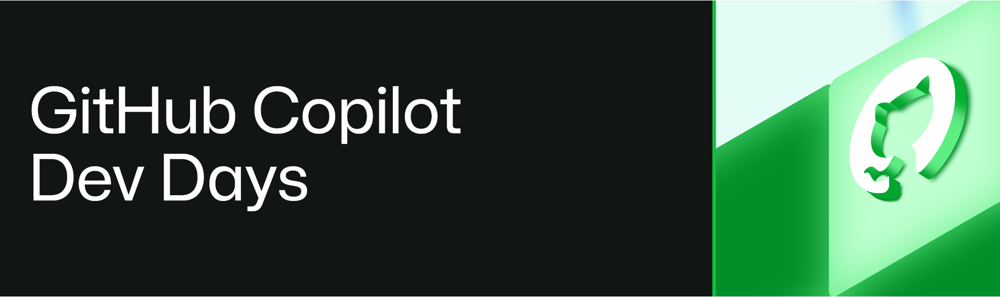

# GitHub Copilot app extensibility

Slides and demos from the talk **Extensibilidad de GitHub Copilot App** (in Spanish) at [GitHub Copilot DevDays Sevilla](https://www.meetup.com/sevilladotnet/events/316793400/), hosted by SevillaDotNet on 28 October 2026.

The talk walks through nine extension points of GitHub Copilot app, each with a small live demo on the same sample app, [copilot-avalonia](https://github.com/jsuarezruiz/copilot-avalonia). The sample uses Avalonia, but none of the pieces depend on it.

## What's inside

Each folder in `demos/` holds the files of one demo, where they go in a repo. Next to it, a `.txt` has the prompts to paste, the commands to run and what you should see. A demo folder has only its own piece, so nothing in one demo comes from another.

| Folder | Extension point | Files |
| --- | --- | --- |
| `demos/00-baseline` | None: the starting point | None |
| `demos/01-instructions` | Instructions | `.github/copilot-instructions.md` and `.github/instructions/axaml.instructions.md` |
| `demos/02-skill` | Skill | `.github/skills/avalonia-automation-ids/SKILL.md` |
| `demos/03-agent` | Custom agent | `.github/agents/avalonia-ui-tester.agent.md` |
| `demos/03b-hierarchy` | One model per role | `.github/agents/`: orchestrator, planner, coder and reviewer |
| `demos/04-mcp` | MCP server | `.mcp.json` and `tools/axaml-inspector/server.mjs` |
| `demos/05-lsp` | LSP server | `.github/lsp.json` with the C# language server |
| `demos/06-hooks` | Hooks | `.github/hooks/guardrails.json` and `guard.mjs` |
| `demos/07-extension` | SDK extension | `.github/extensions/avalonia-tools/extension.mjs` |
| `demos/07b-workflow` | Multi-model workflow | `.github/extensions/plan-code-review/extension.mjs` and the planner, coder and reviewer agents it runs |
| `demos/08-canvas` | Canvas | `.github/extensions/ui-test-plan/extension.mjs` |
| `demos/09-real-canvas` | A real canvas | The demo 8 canvas, next to the Copilot.Avalonia extension that the sample ships |
| `demos/10-plugin` | Plugin | `avalonia-kit/`, a plugin with the skill and the agent. `.github/plugin/marketplace.json` makes this repo its marketplace |

## Running the demos

1. Build the demo folders, once per machine and again after a `git pull`:

   ```bash
   bash setup.sh
   ```

   It creates `~/copilot-talk/` with one folder per demo, `00-baseline` to `09-real-canvas`, and its `.txt` next to it. To use another folder, pass it as the first argument.

2. Add every folder to the app as a project. `setup.sh` prints this command at the end:

   ```bash
   for d in ~/copilot-talk/*/; do open -a "GitHub Copilot" "$d"; done
   ```

   Or add them one at a time in the app with Add repository (File > Create from Local Folder or Repository).
3. Rehearse every demo once. The first session in a folder asks you to trust it: answer it, then start a new session.
4. On stage, pick the folder, press `⌘N` and paste the prompt from its `.txt`. Demo 10 uses `00-baseline`.

Why a script and not the folders in this repo as they are? Each demo needs the sample app, and each has to be the root of its own git repo: the app looks for extensions only at the git root, so demos 7 to 9 would not load from a subfolder. `setup.sh` copies the sample app (pinned to the commit the demos were measured on) and the demo's files into each folder, and commits it.

To try one piece in a repo of your own, copy what's inside its folder to your repo's root, for example `cp -R demos/06-hooks/.github ~/my-project/`.

## Requirements

- GitHub Copilot app. Most demos also work in Copilot CLI.
- .NET 8 SDK or later, plus the .NET 10 SDK for the LSP demo.
- Node.js 22 or later for the MCP server and the hook.
- For demos 03b and 07b, the models named in the agent files must be available to your account. Check `/model` and edit the `model` field if needed.

SDK extensions, canvas and Dynamic Workflows are experimental and may change.

## License

[MIT](LICENSE)
